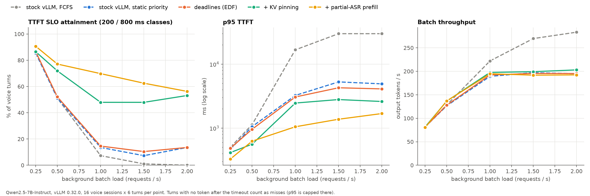

# Voice-aware scheduler for vLLM

Real-time voice agents need the first token before a deadline, and callers interrupt
(barge in) constantly. Stock vLLM throws away a request's KV cache once it ends, so under
mixed voice and batch load every new turn re-prefills the whole conversation behind long
batch prompts.

This project is a drop-in scheduler for vLLM (no fork, loaded with `--scheduler-cls`)
that adds:

- **KV cache kept across barge-in.** When a voice turn ends, finished or interrupted,
  its KV blocks are pinned for a short TTL, so the next turn gets a prefix-cache hit
  instead of being evicted by batch load.
- **Speculative prefill on partial ASR transcripts.** While the user is still speaking,
  the client sends the partial transcript; its KV is computed and pinned, so at end of
  speech only the last few words need prefilling.
- **TTFT-deadline scheduling (EDF).** Each voice request carries its TTFT SLO and is
  ordered by absolute deadline, ahead of batch work.
- **SLO attainment tracking**, server side (logged) and client side (benchmark).

## Results

**Against vLLM's built-in priority scheduling, the full system raises TTFT SLO attainment
from 14% to 70% and cuts p95 TTFT from 3.2 s to 1.05 s** (mixed SLO classes, 1 batch req/s).



Setup: Qwen2.5-7B-Instruct on one NVIDIA A40, vLLM 0.32.0, 4 GB KV cache. 16 voice
sessions x 6 turns per point (~40% of replies interrupted), ~2k-token per-session system
prompt, plus open-loop background batch requests with ~4k-token prompts. Sessions
alternate between a 200 ms and an 800 ms TTFT SLO. TTFT is measured from end of speech
to the first streamed token; a caller hangs up after 30 s without a token (counted as a
miss).

**Arms:** `fcfs` = stock vLLM; `static` = stock vLLM `--scheduling-policy priority`
(tighter class first, batch last); `deadlines` = this scheduler, EDF only;
`+ KV pinning`; `+ partial-ASR prefill` = all features.

### At 1 batch request/s

| | stock FCFS | stock static priority | deadlines (EDF) | + KV pinning | + partial-ASR prefill |
|---|---|---|---|---|---|
| SLO attainment, all turns | 7% | 14% | 15% | 48% | **70%** |
| 200 ms class | 0% | 0% | 0% | 29% | **48%** |
| 800 ms class | 15% | 27% | 29% | 67% | **92%** |
| TTFT p50 | 12.1 s | 1,116 ms | 1,077 ms | 606 ms | **261 ms** |
| TTFT p95 | 16.8 s | 3,243 ms | 3,066 ms | 2,464 ms | **1,048 ms** |
| batch output tok/s | 222 | 189 | 192 | 198 | 195 |

### SLO attainment across load

| batch req/s | stock FCFS | stock static priority | deadlines (EDF) | + KV pinning | + partial-ASR prefill |
|---|---|---|---|---|---|
| 0.25 | 85% | 85% | 86% | 86% | **91%** |
| 0.5 | 51% | 51% | 52% | 72% | **77%** |
| 1 | 7% | 14% | 15% | 48% | **70%** |
| 1.5 | 1% | 7% | 10% | 48% | **62%** |
| 2 | 0% | 14% | 14% | 53% | **56%** |

All tables (p50, p95, throughput, per class): [`results/sweep/mix/tables.md`](results/sweep/mix/tables.md).

### Single 300 ms SLO for every caller

| batch req/s | stock FCFS | stock static priority | deadlines (EDF) | + KV pinning | + partial-ASR prefill |
|---|---|---|---|---|---|
| 0.25 | 86% | 89% | 86% | 90% | **93%** |
| 0.5 | 34% | 34% | 35% | **70%** | 67% |
| 1 | 5% | 5% | 4% | 30% | **53%** |
| 1.5 | 0% | 2% | 2% | 25% | **48%** |
| 2 | 0% | 0% | 0% | 24% | **43%** |

With one SLO class, EDF and static priority produce the same order, and both match FCFS
here. Pinning and prefill again account for the gains: at 1 req/s, 5% to 53%.
Figure and full tables: [`figures/sweep.png`](figures/sweep.png),
[`results/sweep/tables.md`](results/sweep/tables.md).

### Takeaways

- **KV pinning is the main lever.** It roughly triples attainment over stock priority
  scheduling at 1–2 req/s, and is the only thing that gets the 200 ms class above zero.
- **Partial-ASR prefill is the second lever** up to ~1.5 req/s (48% to 70% at 1 req/s,
  p95 2.5 s to 1.05 s). At 2 req/s the server is saturated and the extra speculative
  requests eat most of the gain.
- **Deadline ordering adds little over static priority** in this workload (within a few
  points at every load). Ordering only decides who is admitted next; an admitted voice
  request still shares each step with running batch prefill.
- **The batch throughput cost comes from prioritizing voice at all.** Stock static
  priority pays the same ~195 tok/s as this scheduler above 1 req/s; FCFS keeps more, in
  part because its voice callers time out and leave.

### Caveats

- One run per arm and load; differences of a few points are noise.
- Synthetic workload: random-word prompts, fixed-length replies (`ignore_eos`), simulated
  ASR at one word per 0.3 s.
- Initial single-point runs (before the 30 s hang-up rule) are kept in `results/rps0.5/`
  and `results/rps2.0/`.

## Files

| File | What it is |
|---|---|
| `voice_sched.py` | The scheduler (~130 lines), a subclass of vLLM's scheduler. |
| `bench.py` | Voice sessions with barge-in and partial transcripts, plus batch load. Standard library only. |
| `serve.sh` | Starts vLLM as `baseline` (FCFS), `priority` (stock priority policy) or `voice`. |
| `run_all.sh` | Runs the five arms in one GPU job (SGE / BU SCC). |
| `sweep.sh` | Submits one job per batch load. |
| `plot_sweep.py` | Figure and markdown tables from a sweep. |
| `scc_env.sh` | Environment for BU SCC (venv, caches, CUDA module). |

## How clients use it

Requests are classified by the OpenAI `priority` field:

| `priority` | Meaning |
|---|---|
| `0` or absent | batch, no deadline |
| `N` (0 < N < 1,000,000) | voice turn, TTFT SLO of N ms |
| `1,000,000 + N` | speculative prefill on a partial transcript (`max_tokens=1`), soft deadline N ms |

Tunables (environment): `VOICE_PIN_TTL_S` (default 15, 0 disables pinning),
`VOICE_PIN_MAX_FRAC` (default 0.3 of the KV pool).

## Reproduce

Any machine with one GPU:

```bash
pip install vllm==0.32.0 matplotlib
./serve.sh baseline   # terminal 1, then in terminal 2:
python bench.py --label fcfs --slo-mix 200,800
./serve.sh priority
python bench.py --label static --static-priority --slo-mix 200,800
./serve.sh voice
python bench.py --label voice+prefill --deadlines --prefill --slo-mix 200,800
python bench.py --report results/*.json
```

On BU SCC (SGE): set `WORK` in `scc_env.sh`, create the venv there, then

```bash
./sweep.sh <project> A40                      # single 300 ms SLO
MIX=200,800 TAG=mix ./sweep.sh <project> A40  # two SLO classes
python plot_sweep.py --dir results/sweep/mix --out figures/sweep_mix.png
```

FlashInfer JIT-compiles kernels, so `scc_env.sh` loads a CUDA module and sets
`CUDA_HOME`, and `pip install ninja` is required.

## Limits

Written against vLLM 0.32.0 internals (`_free_request`, block `ref_cnt`,
`block_pool.free_blocks`); other versions may need small changes. Pins expire by TTL
only (no session id). Single KV-cache-group models only. Not production code.
